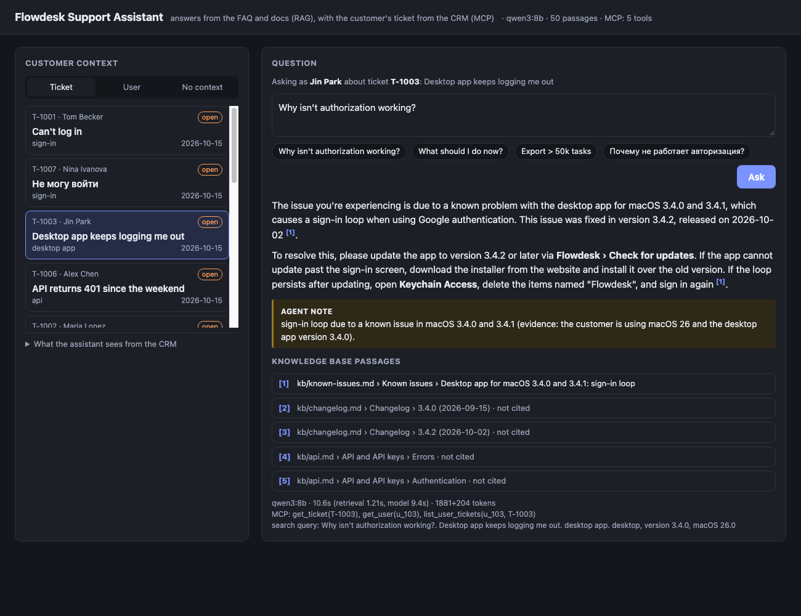

# Task 33 — User support assistant

A mini-service that answers customers' questions about **Flowdesk**, a made-up task tracker for
teams, the way a support agent would: from the product documentation **and** what the support
CRM knows about the customer asking.

- **RAG over the knowledge base**: 13 pages in [`kb/`](kb): FAQ, sign-in and lockout, SSO,
  two-factor, plans and billing, API keys, error codes, known issues, the changelog, members and
  invitations, integrations, export.
- **MCP for the customer's context**: `supportmcp`, a stdio MCP server over
  [`data/crm.json`](data/crm.json) (5 organizations, 12 users, 12 tickets) with `get_ticket`,
  `get_user`, `list_user_tickets`, `search_tickets` and `list_users`.
- **`POST /ask`** and a one-page web UI, plus a CLI. `qwen3:8b` and `nomic-embed-text` in Ollama,
  `bge-reranker-base` from the Hugging Face cache. No API keys, nothing leaves the machine.

```
 POST /ask {"question": "Why isn't authorization working?", "ticket_id": "T-1003"}
   │
   ├─ MCP  get_ticket(T-1003)          subject, error code, app + version + OS, the conversation
   │       get_user(u_103)              account state, sign-in methods and failures, the org's
   │                                    plan, subscription, SSO, admins, integrations, API keys
   │       list_user_tickets(u_103)     earlier tickets and how they were solved
   │
   ├─ query  question + subject + area + error code + environment + flags from the account
   │         "… Desktop app keeps logging me out. desktop app. desktop, version 3.4.0, macOS 26.0"
   ├─ RAG    cosine + BM25 → RRF → bge reranker → 5 passages
   │
   └─ qwen3:8b → the answer to the customer, citing [n], and an "Agent note" for the agent
```



## Run it

```bash
ollama pull qwen3:8b nomic-embed-text
uv run support index                    # embeds kb/ into index/index.db (~2 s)
uv run support serve                    # http://127.0.0.1:8033/
uv run support ask --ticket T-1001 "Why isn't authorization working?"
uv run support ask --user alex@kitelabs.dev "Why does our sync get 401?"
uv run support ask "How long is a password reset link valid?"     # no customer context
uv run support context --ticket T-1005  # what the model would be given, without the model
uv run support eval --ablation          # cases.json, with and without the customer context
uv run pytest                           # 25 tests, no Ollama needed
uv run supportmcp                       # the MCP server alone, for any MCP client (SUPPORT_DATA=...)
```

`ask` also takes `--json` (the full record: context, search query, passages, MCP calls,
timings). The page takes deep links: `/?ticket=T-1003&ask=1`, `/?user=u_106&q=...`, `/?none`.

## The API

| | |
| --- | --- |
| `POST /ask` | `{"question", "ticket_id"?, "user_id"?}` (user id or email) → the answer |
| `GET /context` | `?ticket_id=&user_id=` → the CRM context an answer would use, without the model |
| `GET /tickets`, `GET /users` | the CRM's tickets and users (over MCP), for the page's pickers |
| `GET /health` | model, number of passages, the MCP tools |

An unknown ticket or user is a 404, Ollama down a 503. `POST /ask` returns:

```json
{
  "question": "Why isn't authorization working?",
  "answer": "The issue is likely due to your device's clock being out of sync, which is causing the two-factor authentication code to be invalid. … [2]\n\nTo fix this:\n1. On your Android phone, turn on automatic date and time … ",
  "agent_note": "device clock discrepancy (evidence: manual time setting after traveling)",
  "ticket_id": "T-1004",
  "user_id": "u_104",
  "context": [{"name": "TICKET", "text": "ticket T-1004 · status open · …"}, {"name": "CUSTOMER AND ORGANIZATION", "text": "…"}],
  "search_query": "Why isn't authorization working?. Verification code rejected. sign-in. error AUTH_401_OTP_INVALID. mobile, Android 16, version 3.4.2",
  "passages": [{"rank": 1, "label": "kb/…", "source": "kb/…", "text": "…", "rerank": 0.0, "cited": false}, …],
  "crm_calls": [{"tool": "get_ticket", "arguments": {"ticket_id": "T-1004"}}, {"tool": "get_user", …}, {"tool": "list_user_tickets", …}],
  "model": "qwen3:8b", "seconds": 11.4, "timings": {"retrieval": …, "llm": …}, "tokens": {"prompt": …, "completion": …}
}
```

## One question, seven answers

The example from the brief, "Why isn't authorization working?", is asked on seven tickets.
Every ticket has a different cause, and the CRM shows it:

| ticket | what the CRM says | the answer (qwen3:8b, abridged) |
| --- | --- | --- |
| T-1001 Tom | `LOCKED` since 11:40 after 5 failed passwords, ends 12:10 | locked for 30 min, ends 12:10; reset the password or ask Jin Park or Raj Patel to unlock |
| T-1002 Maria | org Acme: SSO `REQUIRED` via Okta; `AUTH_403_SSO_REQUIRED` | your organization requires SSO through Okta; use **Sign in with SSO** |
| T-1003 Jin | desktop app 3.4.0 on macOS 26, back to the sign-in screen | known sign-in loop in 3.4.0–3.4.1, fixed in 3.4.2: update; Keychain fallback |
| T-1004 Sara | `AUTH_401_OTP_INVALID` ×6, "set the time on my phone by hand" | the phone's clock is off: automatic time, Authenticator's "Sync now", or a backup code |
| T-1005 Daniel | Northwind `PAST DUE` 17 days, `SUSPENDED` since Monday | the workspace is suspended for an unpaid invoice; Priya Raman (billing admin) pays in Admin › Billing |
| T-1006 Alex | key `fd_live_3f9a` `REVOKED` 2026-10-10: its creator Leo was deactivated | the key was revoked when Leo Martin was deactivated; create a new key, replace it |
| T-1007 Nina (ru) | `INVITED`, invitation sent 9 days ago by Owen Grant | приглашение действительно 7 дней и истекло; попросите Owen Grant отправить его заново |

Without a ticket, the same question gets a generic answer that's no use to any of them. The
word "authorization" pulls in the API docs (the `Authorization` header), so the model explains
API keys:

> If you're experiencing issues with authorization, it could be due to several reasons. First,
> ensure that you are using the correct API key in the `Authorization` header…

### A transcript

Unedited (`uv run support ask`, output piped, so no colours):

```
$ uv run support ask --ticket T-1002 "Why isn't authorization working?"
ticket T-1002, user u_101

Your organization, Acme Logistics, requires single sign-on (SSO) through Okta, and this is why you're seeing the `AUTH_403_SSO_REQUIRED` error. The email and password form no longer works for you since the "Require SSO" setting was enabled [1]. To resolve this, use the **Sign in with SSO** option on the sign-in page. This will redirect you to your company's identity provider (Okta) to complete the login process [3].

agent note Require SSO is enabled for the organization (evidence: single sign-on is REQUIRED via Okta).

sources
  [1] kb/sso.md › Single sign-on (SSO) › Require SSO
  [3] kb/sso.md › Single sign-on (SSO) › Signing in with SSO
MCP: get_ticket(T-1002), get_user(u_101), list_user_tickets(u_101, T-1002) · 2166+129 tokens · 14.4s
```

## How it works

1. **Context is fetched, not left to the model.** With `ticket_id`, the service calls
   `get_ticket`, then `get_user` for the ticket's author and `list_user_tickets` for their
   other tickets. With only `user_id`, the last two. This happens before the model runs. If an
   8B model decided whether to look, it would sometimes skip it and answer generically, which is
   exactly the failure the task is about.
2. **The MCP server returns facts, not JSON.** `get_user` says `account status: LOCKED since
   2026-10-15 11:40 UTC (20 min ago) … the lock ends 2026-10-15 12:10 UTC (in 10 min)` and
   `single sign-on: REQUIRED via Okta (SAML 2.0) for acme-logistics.com`. Ids come with names,
   dates with how long ago they were (from the data file's `today`, so the demo doesn't age).
   A small model reads "sent 9 days ago" reliably. It doesn't reliably subtract timestamps.
3. **The ticket steers retrieval.** The search query is the question plus the ticket's subject,
   area, error code and environment, the error codes of the user's recent failures, and words
   for the account states the CRM flags. For example, `account status: LOCKED` adds "account
   locked too many attempts lockout". BM25 keeps an error code like `AUTH_423_LOCKED` as one
   token, so the matching table row and section come up. The rerank uses the same query.
4. **One model call.** The system prompt asks for the cause for *this* customer and the fact
   that shows it, the steps from the passages, and who has to act, by name. It also asks for no
   internal ids, the language of the question, and a closing `Agent note:` line for the support
   agent, which is split off. A citation `[n]` that points at no passage is removed.
5. **The service** keeps one MCP session open for its lifetime and answers one request at a
   time (there is one local model). The reranker is loaded at startup, not on the first request.

## Results

`uv run support eval --ablation`: the 13 cases in [`cases.json`](cases.json). There are the
seven auth tickets above, a CSV export ticket and a Slack ticket, a ticketless owner ("Nobody on
my team can sign in", as Priya), and three product questions without context. Each answer is
checked for the facts it must contain (and the ones it must not), and retrieval is checked for
an expected section among the 5 passages. `--ablation` runs the 10 cases that have context a
second time without it. qwen3:8b, M1 Pro.

```
all cases (13)
  passed          13/13
  retrieval hit   13/13
  answer checks   13/13
  cites a passage 13/13
  mean time       14.0s

cases with customer context (10), with it
  passed          10/10
  retrieval hit   10/10
  answer checks   10/10
the same cases, without it
  passed          3/10
  retrieval hit   6/10
  answer checks   3/10
```

| case | with context | without |
| --- | --- | --- |
| locked, sso, desktop, 2fa, suspended, api-key, invite-ru | ✓ | ✗ (an API-key answer, or a list of every possible cause) |
| export ("Why does my export fail?") | ✓ | ✓: the question alone names the feature, and the FAQ answer is the same for everyone |
| slack ("Why did our notifications stop?") | ✓ | ✓: "reconnect" is the docs' first suggestion anyway |
| owner-user ("Nobody on my team can sign in") | ✓: "your workspace is suspended; as the owner and billing admin, pay in Admin › Billing" | ✓ on the checks, but as cause 1 of 5 |

The three that pass without context are the honest part of the result. When the question
itself names the problem, the docs are enough. When it doesn't ("authorization isn't working"),
only the CRM can tell the causes apart. Full record:
[`results/eval-20261015T214659.json`](results/eval-20261015T214659.json).

## What testing changed

- **Org-wide flags are only a lead without a ticket.** The first query for Tom's lockout
  (T-1001) included "integration disconnected reconnect", because his organization's Slack is
  broken. Account and subscription states always go into the query. A revoked key or a
  disconnected integration goes in only when there's no ticket to say what's wrong.
- **No internal ids.** Nina's answer said "Owen Grant (u_110)". The prompt now forbids ids. One
  answer in the final run still wrote "Leo Martin (u_108)".
- **A citation reminder after the question.** Daniel's answer on the page used the billing
  passage and cited nothing. A one-line reminder at the end of the prompt fixed it, and all 13
  eval answers cite.
- **Whole days.** "17.5 days ago" was rounded to 18. Days are now counted whole, matching how
  people count.
- **Errors inside the MCP session.** An unknown ticket raised inside the MCP client's
  `async with` came out as an `ExceptionGroup`. The CLI now catches the error inside and raises
  it after the session closes.

## Limits

- An 8B model fills gaps. Nina's invitation was "sent 9 days ago" and one answer said it
  "expired 9 days ago". Another suggested a key scope (`tasks:read`) that nothing in the ticket
  asked for. The facts and the citations show where a claim came from, but a sentence without
  either can still be a guess.
- The agent note is a line the model writes, not a structured field. When the model leaves it
  out, the note is empty.
- The CRM is a read-only JSON file. A real desk would also want write tools (add an internal
  note, change the status, send the reply), and those should require a person's approval.
- The cases were written alongside the knowledge base and the data, so 13/13 shows the pipeline
  works, not how it would do on real tickets. The ablation is the more telling number.
- The assistant answers whoever asks with that customer's data. The service has no
  authentication, so it's for a support agent on their own machine, not for the public.

## Files

- [`kb/`](kb), [`data/crm.json`](data/crm.json): the product docs and the CRM
- [`supportmcp/crm.py`](supportmcp/crm.py), [`server.py`](supportmcp/server.py): the CRM as text, the MCP server
- [`support/crm_client.py`](support/crm_client.py): the MCP client (stdio)
- [`support/kb.py`](support/kb.py), [`embed.py`](support/embed.py), [`store.py`](support/store.py), [`index.py`](support/index.py): chunking, embeddings, SQLite, incremental build
- [`support/lexical.py`](support/lexical.py), [`rerank.py`](support/rerank.py), [`retrieve.py`](support/retrieve.py): BM25, cross-encoder, hybrid retrieval
- [`support/assistant.py`](support/assistant.py): context, search query, prompt, agent note, citations
- [`support/service.py`](support/service.py), [`static/index.html`](support/static/index.html): `POST /ask` and the page
- [`support/cli.py`](support/cli.py), [`evaluate.py`](support/evaluate.py), [`cases.json`](cases.json), `results/`: CLI and evaluation
- [`tests/`](tests): the CRM rendering and every MCP tool over a real client (in process and stdio); chunking, BM25 and the incremental index with a fake embedder; the assistant and every endpoint with a scripted LLM
