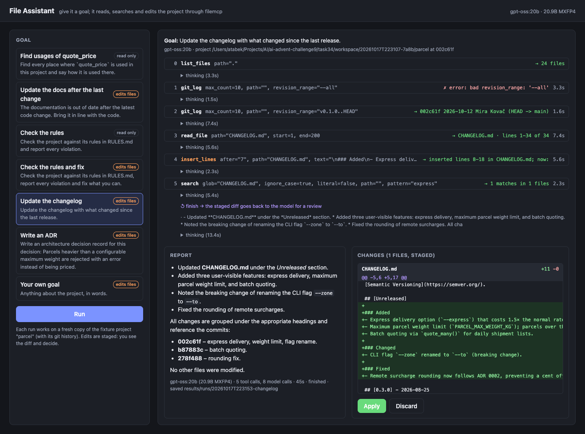

# Task 34 — Project file assistant

An assistant that works on a project's files instead of only answering in text. You give it a
goal ("the docs are out of date after the last change, fix them"), not "open file X". It decides
what to list, search, read and look up in git, makes the edits, and ends with a report and a
diff that you apply or discard.

- **`filemcp`**: a stdio MCP server over one project directory. It has read and search tools
  (`list_files`, `read_file`, `search`, `outline`), read-only git tools (`git_log`, `git_show`,
  `git_diff`) and write tools (`edit_file`, `insert_lines`, `write_file`). The writes go to a
  **staging overlay** in memory, not the disk, and the server can't leave its root or delete
  anything.
- **`fileassist`**: the agent loop, five preset scenarios, a CLI, a web UI with live tool calls
  and Apply/Discard, and an eval that checks the results by code.
- **`fixture/`**: "parcel", a small shipping-cost library with seven commits of git history and
  planted problems. Each run starts from a fresh, byte-identical build of it (HEAD is always
  `002c61f`).
- `gpt-oss:20b` in Ollama. No API keys; nothing leaves the machine.

```
 fileassist update-docs
   │
   ├─ fixture     replay fixture/ into workspace/<time>/parcel as a git repo (fixed authors, dates)
   ├─ MCP         filemcp over stdio, rooted there
   │
   └─ gpt-oss:20b ⇄ tools, up to 40 calls
        list_files · search · outline · read_file · git_log · git_show · git_diff     explore
        edit_file · insert_lines · write_file                                        staged in memory
        finish(report) → the staged diff goes back once for a review → finish
   │
   └─ results/runs/<time>-update-docs/  transcript.json · report.md · changes.diff
      --apply (CLI) or Apply (web) writes the diff to the files
```



## Run it

```bash
ollama pull gpt-oss:20b
uv run fileassist usages quote_price     # where and how a function is used (read only)
uv run fileassist update-docs            # bring the docs in line with the last commit
uv run fileassist check                  # check the project against RULES.md (read only)
uv run fileassist check --fix            # ... and fix what it can
uv run fileassist changelog              # fill [Unreleased] from the commits since the last tag
uv run fileassist adr "Parcels over the maximum weight are rejected"   # a new ADR + index row
uv run fileassist run "The README still shows --zone. Fix it."         # any goal, in words
uv run fileassist serve                  # the web UI on http://127.0.0.1:8034/
uv run fileassist eval                   # cases.json; --models a,b --cases id,... --repeat N
uv run fileassist fixture /tmp/parcel    # build the fixture to look at it
uv run pytest                            # 49 tests, no Ollama needed
uv run filemcp --root DIR                # the MCP server alone, for any MCP client
```

Common flags: `--root DIR` works on your own project instead of a fresh fixture. `--apply`
writes the diff. `--model`, `--think low|medium|high` (gpt-oss's reasoning level, default
`low`) and `--steps` set the model, its reasoning and the budget.

## The scenarios

The goal of each preset names no files. A short "how to do it well" checklist follows it, for
example "start from `git_show` of the last commit", "for each alias you find, search for it too"
or "a new setting gets a row next to the other settings".

| scenario | what it does | writes |
| --- | --- | --- |
| `usages SYMBOL` | every place a name is used: definition, re-exports, imports, aliases (`as qp`), calls through the module, mocks as strings, docs. A `file:line` table | — (no write tools offered) |
| `update-docs` | reads the last commit with `git_show`, lists the user-visible changes, finds every doc that describes the old behaviour | README, docs/, .env.example |
| `check [--fix]` | each rule in `RULES.md` against every file it covers; `--fix` adds docstrings, docs and a test file, and removes a library `print` | with `--fix` |
| `changelog` | commits since the last tag → `[Unreleased]` in Keep a Changelog form | CHANGELOG.md |
| `adr DECISION` | finds the commit, date, author, code and settings behind a decision; writes `docs/adr/NNNN-*.md` from the template and adds the index row | docs/adr/ |

### A transcript

`fileassist run "The code reads an environment variable for the maximum parcel weight that the
configuration docs and .env.example don't mention yet. Document it."` (eval case
`document-env-var`, 30 s):

```
  0 list_files(path=".") → 24 files                                       ← the agent's first call
  1 search(pattern="MAX_PARCEL_WEIGHT", glob="**/*.py") → no matches … search for a shorter part
  2 search(pattern="env", glob="**/*.py", ignore_case=true) → 17 matches in 4 files
  3 read_file(path="parcel/config.py") → lines 1-25 of 25
  4 read_file(path="docs/configuration.md") → lines 1-10 of 10
  5 read_file(path=".env.example") → lines 1-3 of 3
  6 edit_file(path="docs/configuration.md", old="| `PARCEL_FUEL_SURCHARGE` …", new="… + new row")
  7 edit_file(path=".env.example", old="PARCEL_CURRENCY=EUR\nPARCEL_FUEL…", new="… + new line")
  8 search(pattern="max weight", glob="**/*.md") → no matches                ← its own leftover check
    ↺ finish → the diff goes back to the model for a review
    finish
```

```diff
--- a/.env.example
+++ b/.env.example
@@ -1,3 +1,4 @@
 # parcel settings, all optional
 PARCEL_CURRENCY=EUR
 PARCEL_FUEL_SURCHARGE=0.00
+PARCEL_MAX_WEIGHT_KG=30
--- a/docs/configuration.md
+++ b/docs/configuration.md
@@ -6,5 +6,6 @@
 | `PARCEL_CURRENCY` | `EUR` | currency code printed next to prices; it doesn't convert anything |
 | `PARCEL_FUEL_SURCHARGE` | `0.00` | fuel surcharge as a fraction of the price, e.g. `0.08` for 8 % |
+| `PARCEL_MAX_WEIGHT_KG` | `30` | maximum parcel weight in kilograms that the API accepts
```

The `changelog` run makes 4 calls. Two `git_log` calls give the commits and the `v0.3.0` tag,
it reads `CHANGELOG.md`, and one `insert_lines` puts the new entries under `[Unreleased]`:
- Added: express, `PARCEL_MAX_WEIGHT_KG`, `quote_many`;
- Changed: `--zone` → `--to`, marked "breaking";
- Fixed: the rounding of the remote surcharge.

It leaves out the internal `resolve_zone` refactor. The commit messages were enough, so it
didn't `git_show` any commit. As a result it missed that the HTTP parameter was renamed too. The `adr` run takes the date
(2026-10-12) and the author (Mira Kovač) from the commit that added the limit, and names
`PARCEL_MAX_WEIGHT_KG` and `WeightLimitError` in the context.

## The web UI

`fileassist serve`: pick a scenario (the argument is prefilled) or type a goal, and press Run.
The tool calls stream in over SSE as the model makes them; each one expands to its arguments
and result. When the run ends, the report (rendered Markdown) and the diff (per file, coloured)
appear side by side. **Apply** writes the diff into the run's project, and **Discard** drops it.

| | |
| --- | --- |
| `GET /scenarios` | the presets, for the picker |
| `POST /runs` | `{"scenario", "arg"?}` or `{"goal"}` → `{"id"}`; a fresh fixture build per run, one run at a time |
| `GET /runs/{id}/events` | server-sent events: `start`, `call`, `think`, `review`, `stop`, then `done` (report, diff, stats) |
| `POST /runs/{id}/apply`, `/discard` | write or drop the staged changes |
| `GET /health` | model, version, whether Ollama answers |

The run's MCP session stays open until Apply or Discard (or the next run). So the diff on the
page is exactly what the server would write. Deep links start a run: `/?scenario=changelog&run=1`,
`/?scenario=usages&arg=resolve_zone&run=1`, `/?goal=...&run=1`.

## Results

`fileassist eval`: the 10 cases in [`cases.json`](cases.json), checked by code on the report,
the diff and the files after the diff is applied. The checks cover:
- the `file:line` places the report must mention;
- the files that must change and the ones that must not;
- the text the files must and must not contain, e.g. no `--zone` left and no `[--express]`
  placeholder in an example;
- for the settings case, that no existing line was deleted and the new row really is inside
  the table;
- for `check --fix`, that the project's own tests still pass.

A case passes when all of its checks do. The checks are themselves tested on hand-made right
and wrong answers (`tests/test_evaluate.py`). Apple M1 Pro, 32 GB.

`gpt-oss:20b`, two eval sessions. **A** is 3 runs per case, before the last two guards
([`results/eval-20261017T210431.md`](results/eval-20261017T210431.md)). **B** is 1 run per
case on the final code, later in the evening
([`results/eval-20261017T223210.md`](results/eval-20261017T223210.md)):

| case | A: passed | A: checks | B: passed | B: checks | B: calls | B: time |
| --- | --- | --- | --- | --- | --- | --- |
| usages-quote_price | 0/3 | 7/8 | ✓ | 8/8 | 13 | 136 s |
| usages-WeightLimitError | 3/3 | 7/7 | ✓ | 7/7 | 5 | 48 s |
| update-docs | 0/3 | 14/15 | ✗ | 10/15 | 32 | 104 s |
| update-docs-vague | 0/3 | 7/8 | ✗ | 7/8 | 11 | 61 s |
| document-env-var | 3/3 | 9/9 | ✓ | 9/9 | 6 | 31 s |
| check | 0/3 | 5/8 | ✗ | 6/8 | 20 | 64 s |
| check-fix | 0/3 | 7/9 | ✗ | 6/9 | 23 | 116 s |
| changelog | 3/3 | 13/13 | ✓ | 13/13 | 5 | 44 s |
| adr | 3/3 | 8/8 | ✓ | 8/8 | 13 | 62 s |
| adr-from-history | 3/3 | 6/6 | ✓ | 6/6 | 13 | 63 s |
| **all** | **15/30** (5 cases) | **91 %** | **6/10** | **87 %** | 13 | 62 s |

Within session A, the three runs of each case were identical: temperature 0, a fixed seed, the
model loaded once. Session B used the same settings and took different paths on some cases.
So a result repeats while the model stays loaded, but not reliably across sessions. Read the
table as "about 5–6 of 10, about 90 % of the checks".

Always right in both sessions: `changelog`, both `adr` cases, `document-env-var` and
`usages-WeightLimitError`. What went wrong:

- **usages-quote_price** (A): every use, including the `qp` alias, the call through `rates.` and
  the monkeypatch string. But the definition appears only as "defined in `parcel/rates.py`",
  without its line. B listed it.
- **update-docs**: A got all four files right (README, usage CLI and HTTP sections, the settings
  table, `.env.example`). The exception is one example that now reads `$ parcel quote 2.5 --to
  FR [--express]`, a placeholder in a command whose real output follows it. B fixed the CLI
  docs, then repeated a search until the loop guard stopped it, before it reached the settings.
- **update-docs-vague** ("Mira changed the command line last week…"): `--zone` → `--to`
  everywhere, but `--express` not documented, in both sessions.
- **check**: A found 4 of the 7 planted violations: the missing docstring, the library `print`,
  the undocumented `PARCEL_MAX_WEIGHT_KG` and the TODO without an issue. B also found
  `PARCEL_API_PREFIX`. Both missed `parcel.batch` absent from the Modules table and the
  missing `tests/test_batch.py`. For both rules they wrote "no violations" without listing the
  modules. Neither run flagged a near-miss: the `print` in the CLI, the TODO with an issue, the
  private helper.
- **check-fix**: the print removed, docs added and a new `tests/test_batch.py`. But there was
  no `PARCEL_API_PREFIX` row and no docstring for `resolve_zone`. In A the project's tests
  still passed. In B the new test file had a failing test (`1 failed, 20 passed`), which the
  model never saw because it can't run tests.

The qwen3 models, 1 run per case, thinking off
([`results/eval-20261017T213718.md`](results/eval-20261017T213718.md)):

A cell shows ✓ when the case passed, then checks passed and the time.

| case | `qwen3:8b` | `qwen3:8b-q8_0` | `qwen3:14b` |
| --- | --- | --- | --- |
| usages-quote_price | ✓ 8/8 · 105 s | 1/8 · 29 s | 2/8 · 347 s |
| usages-WeightLimitError | ✓ 7/7 · 24 s | 2/7 · 25 s | ✓ 7/7 · 121 s |
| update-docs | 3/15 · 44 s | 3/15 · 86 s | 3/15 · 233 s |
| update-docs-vague | 2/8 · 43 s | 2/8 · 39 s | 3/8 · 98 s |
| document-env-var | 7/9 · 32 s | 7/9 · 33 s | ✓ 9/9 · 79 s |
| check | 1/8 · 97 s | 1/8 · 27 s | 1/8 · 51 s |
| check-fix | 3/9 · 37 s | 3/9 · 49 s | 3/9 · 110 s |
| changelog | 6/13 · 56 s | 2/13 · 48 s | 12/13 · 102 s |
| adr | 0/8 · 77 s | 0/8 · 28 s | 6/8 · 152 s |
| adr-from-history | 0/6 · 57 s | 0/6 · 48 s | 0/6 · 393 s |
| **all** | **2/10 · 40 %** · 50 s | **0/10 · 23 %** · 36 s | **2/10 · 50 %** · 115 s |

gpt-oss passes 5–6 of 10 cases with about 90 % of the checks. The best qwen model passes 2,
with 50 %. The one case where a qwen model beat session A is `usages-quote_price`, where
`qwen3:8b` listed the definition's line. The 8-bit quantization of the 8B did worse than the default 4-bit one, so
precision alone didn't help. The usual way a qwen run ends: 14 of the 20 runs of the 8B models,
and 3 of the 14B's 10, repeat an identical `search` after being told it's a repeat, until the
third copy ends the run. The rest is the smoke-test pattern:
`edit_file` replacing a line instead of adding one. With thinking on, `qwen3:14b` did better
on a small goal but took 3–7 minutes a run (see [PLAN.md](PLAN.md#model)).

## What testing changed

Every guard in the tools came from a failed run:

- **Replacing instead of adding.** All the qwen models, and gpt-oss in `check --fix`, "added" a
  line by `edit_file`-ing its neighbour away: the `PARCEL_FUEL_SURCHARGE` line, or a `def` line
  replaced by the docstring meant for it.
  - A separate `insert_lines(path, after, text)` adds lines. `after` can be a line number, the
    line's text, or a fragment unique to one line.
  - The `edit_file` result lists the lines it removed.
  - `edit_file` now **refuses** a change that deletes a `def`/`class` or leaves a Python file
    unparseable. The error says to use `insert_lines`. The orphaned docstring had parsed fine,
    as the end of the previous class, so a syntax check alone wouldn't have caught it.
- **Lines in the wrong place.** A paragraph went inside a ```` ``` ```` block, and a table row
  went after the blank line that ends the table. `insert_lines` now says so in its result
  ("inside the code block of lines 35–40; it belongs after line 40"). gpt-oss then moves the
  line.
- **A report that turned into edits.** `check` answered in text. The nudge back to the tools
  ended with "edits are staged, so make them", and the model started fixing. Now the nudge is
  neutral, and read-only scenarios are not offered the write tools at all.
- **Pasted prefixes, guessed globs.** Models copied `12| ` into `old` and wrote
  `"*.md|*.py"` as a glob. Both are now accepted.
- **Loops.** A repeated read-only call gets its earlier result back with a warning. The third
  identical call ends the run, with the staged changes kept.
- **The same block twice.** The first web-UI run of `changelog` wrote its `finish` as JSON text.
  The review then made it insert all its entries a second time, instead of correcting the first
  insert. A reply that is a JSON `{"report": ...}` now counts as `finish`. `insert_lines`
  refuses a block of two or more lines that is already in the file, and says how to move it
  instead.
- **A review before finishing.** The first `finish` with staged changes gets the diff back,
  with the deleted lines listed, and the model fixes what's wrong before it finishes again.

## Limits

- **5–6 of 10 cases.** The misses are the kind a reviewer would catch in the diff. That's why
  nothing is written until Apply. But it means the assistant drafts the change and a person
  still checks it.
- **"Every X" rules are the weakest point.** "Every module has a test", "every setting is
  documented": gpt-oss checked the items it came across, not the full list, even with a
  checklist line telling it to list them first.
- **The fixture was written with the cases.** The checks know where the planted problems are,
  so the numbers show what the assistant does on this project, not on any project. `--root`
  works on a real one, without the checks.
- **Reproducible, mostly.** At temperature 0 with a fixed seed, the eval's three repeats were
  identical. But a later web-UI run of `changelog` took a different path (5 calls instead of 4).
  So "same input, same output" holds in practice, not as a guarantee. A different wording of the
  goal changes the result more, as `update-docs-vague` shows.
- **No shell.** The assistant can't run the tests itself. The eval runs them after applying the
  diff, but the model never sees the result.

## Files

- [`fixture/`](fixture), [`fileassist/fixture.py`](fileassist/fixture.py): the parcel project's 7 commits and the deterministic replay
- [`filemcp/workspace.py`](filemcp/workspace.py), [`server.py`](filemcp/server.py): the jailed root, the staging overlay, the guards, the MCP tools
- [`fileassist/files_client.py`](fileassist/files_client.py): the MCP client (stdio, or in process for tests)
- [`fileassist/llm.py`](fileassist/llm.py), [`agent.py`](fileassist/agent.py): Ollama with tools; the loop, its limits, the review
- [`fileassist/scenarios.py`](fileassist/scenarios.py): the five goals and their checklists
- [`fileassist/web.py`](fileassist/web.py), [`static/index.html`](fileassist/static/index.html): the service and the page
- [`fileassist/cli.py`](fileassist/cli.py), [`runs.py`](fileassist/runs.py), [`evaluate.py`](fileassist/evaluate.py), [`cases.json`](cases.json), `results/`: CLI, saved runs, evaluation
- [`tests/`](tests): the fixture build; every tool, the jail and the guards over a real MCP client; the loop with a scripted model; the eval checks; the web service end to end
